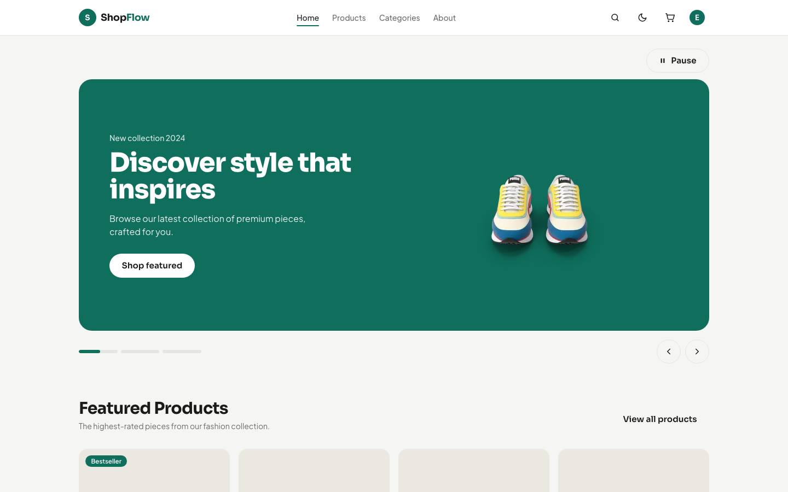
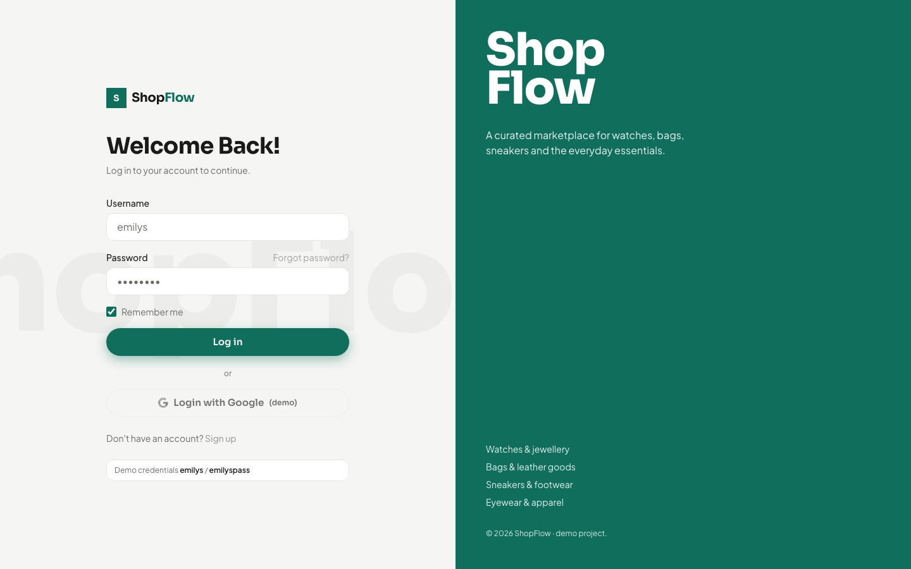
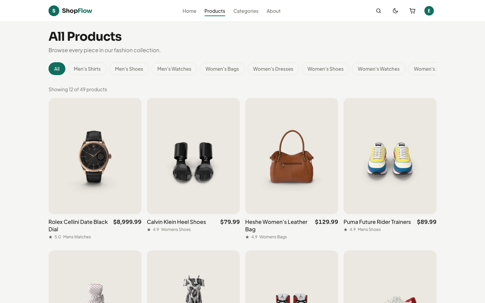
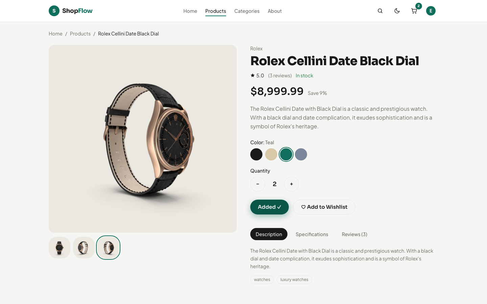
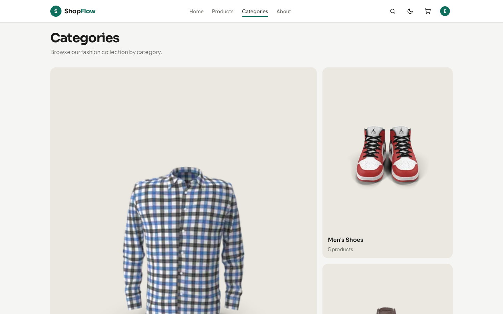
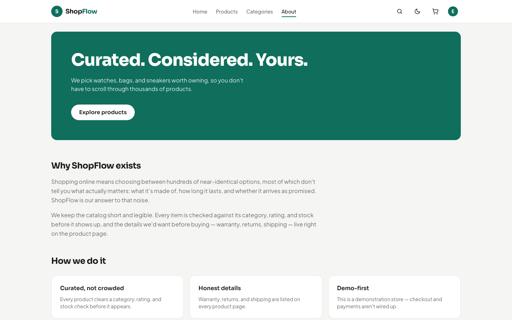
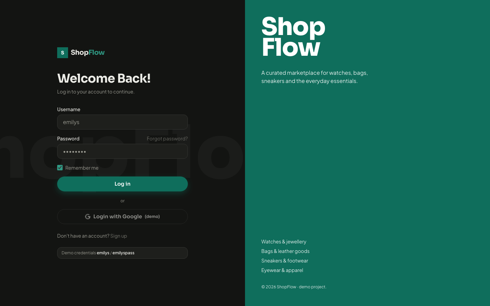
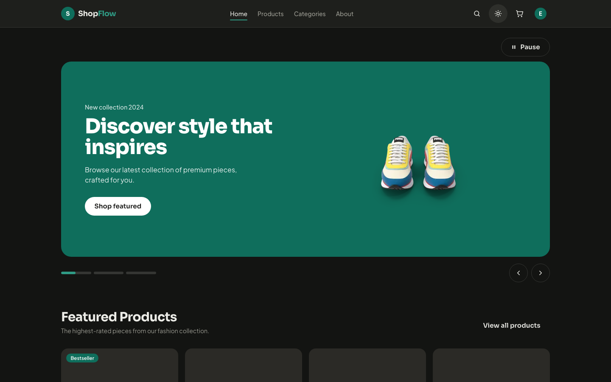
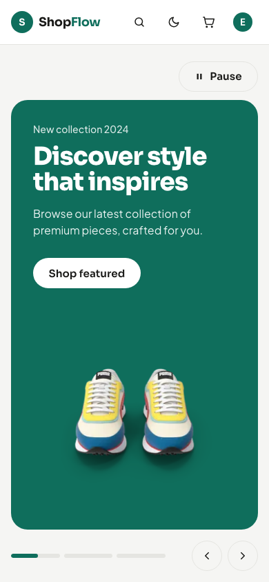

# ShopFlow: Angular e-commerce demo

A small, polished e-commerce front-end built for a front-end technical assessment (sign-in, home, products, product detail, categories, and about) on Angular 22 + Tailwind CSS v4, with all data coming from the public dummyjson API.



## What it does

- **Sign in** with a validated form wired to `dummyjson /auth/login`: inline errors, pending state, and return-to-origin after redirect.
- **Protected routes**: home and product detail are guarded; anonymous visitors are sent to sign-in and returned after logging in.
- **Home**: one accessible hero slider (pause/play, arrows, progress indicator, reduced-motion) and a curated grid of fashion products.
- **Products**: the full catalog without the hero, filterable by category chips and search, with load-more pagination.
- **Product detail**: a real product by id (deep-link and refresh safe): gallery, price/rating/stock, color swatches + quantity, description/specifications/reviews, add-to-cart feedback, wishlist toggle.
- **Search, cart, and profile** in the navbar: search filters the products page, cart tracks selections in-memory, profile shows the signed-in account.
- **Categories**: a tile grid of the fashion categories with live product counts; each tile filters the products page by category.
- **About**: a short brand story, values, and how-it-works.
- **Logout**, a **dark-mode** toggle (persisted), loading/error/empty states everywhere, keyboard and screen-reader support.

## Demo credentials

- Username: `emilys`
- Password: `emilyspass`

## Tech stack

- **Angular 22.3**: standalone components, signals, zoneless change detection, `httpResource`, functional `CanActivateFn` and `HttpInterceptorFn`, lazy routes.
- **Tailwind CSS 4.3**: CSS-first config, semantic tokens in `@theme inline`, class-based dark mode.
- **TypeScript 6.0**.
- **Data**: [dummyjson](https://dummyjson.com/docs/products).

## Getting started

Requirement: Node `^24.15.0` or `>=26.0.0` (see `.nvmrc`).

```bash
npm ci
npm start        # http://localhost:4200
```

Other scripts:

```bash
npm run build    # production build
npm test         # unit tests (Vitest)
```

## Project structure

```
src/app/
  core/        auth service, guard, interceptor, product + cart services, models, categories
  shared/      navbar, footer, hero slider, product card
  features/    login, home, products, product detail, categories, about
  app.routes   lazy routes with guards
```

## Decisions & trade-offs

- **Login API: dummyjson, not reqres.in.** `dummyjson /auth/login` validates credentials (a wrong password returns `400`), which actually demonstrates form validation. reqres.in's keyless tier accepts any password for a known email and shares a low daily quota. reqres.in (`eve.holt@reqres.in` / `cityslicka`) remains a documented fallback.
- **Design.** A distinctive "editorial marketplace" direction: deep petrol teal on neutral chalk, Sora + Plus Jakarta Sans, and prices set in tabular figures. The reference structure is kept; the visual language is re-themed rather than cloned.
- **Data authenticity.** The grid and detail pages are driven by the API. Products are curated to fashion categories and sorted by rating so the store reads coherently. There is no hardcoded product data.
- **Cart / wishlist** give local-state feedback only: the brief asks for the buttons and API-backed data, not persistence.
- **No SSR, no state library, no UI kit**: Angular idioms and Tailwind only, to keep the surface small and readable.

## Out of scope

Sign-up, Google OAuth, password reset, cart/checkout, payments, and server-side search/pagination. The Google / Forgot password / Sign up controls are shown but disabled with a visible "demo" cue.

## API notes

- Products: `GET https://dummyjson.com/products` (open CORS; transparent thumbnails served from `cdn.dummyjson.com`).
- Login: `POST https://dummyjson.com/auth/login`.
- The demo is read-only; writes are not persisted by the API.

## Accessibility

- WCAG AA text contrast, visible `:focus-visible` rings, targets at least 44px.
- The carousel follows the W3C ARIA APG carousel pattern with a pause control and `prefers-reduced-motion` handling.
- Semantic HTML, labelled controls, inline errors linked with `aria-describedby`, and live-region feedback.

## Screenshots

| Login | Home | Products | Product | Categories | About |
| --- | --- | --- | --- | --- | --- |
|  |  |  |  |  |  |
|  |  |  | | | |
